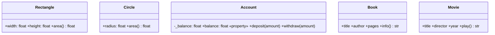

# 02 · OOP basics (OOP exercises notebook 1)

Five warm-up classes: attributes, methods and `__init__`.

| # | Exercise | Class |
|---|---|---|
| 1 | Rectangle with `width`, `height` and `area()` | `Rectangle` |
| 2 | Circle with `radius` and `area()` | `Circle` |
| 3 | Bank account with `deposit()`, `withdraw()` and a `balance` | `Account` |
| 4 | Book with `title`, `author`, `pages` and `info()` | `Book` |
| 5 | Movie with `title`, `director`, `year` and `play()` | `Movie` |

Design choices: input validation raises `ValueError` (negative sizes, invalid amounts), and `Account.balance` is a read-only `@property` so the balance can only change through `deposit`/`withdraw` (encapsulation).

Run: `pytest 02_oop_basics`
