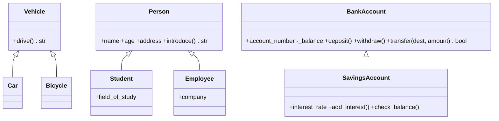

# 04 · Inheritance (OOP exercises notebook 2, part 2)

| # | Exercise | Concepts |
|---|---|---|
| 1 | `Vehicle.drive()` overridden by `Car` and `Bicycle` | overriding, polymorphism |
| 2 | `Person.introduce()` with `Student` and `Employee` subclasses | `super().__init__`, overriding |
| 3 | `BankAccount` → `SavingsAccount` with interest, `check_balance` and `transfer` | reuse of parent methods via `super()` |

`add_interest()` calls the parent's `deposit()` (as the exercise asks) instead of touching the balance directly, so every rule on deposits still applies.

Run: `pytest 04_inheritance`
