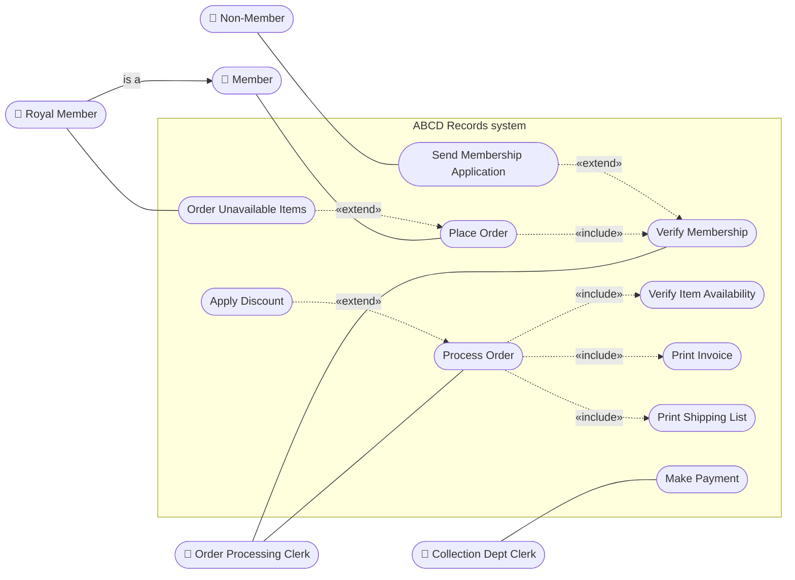
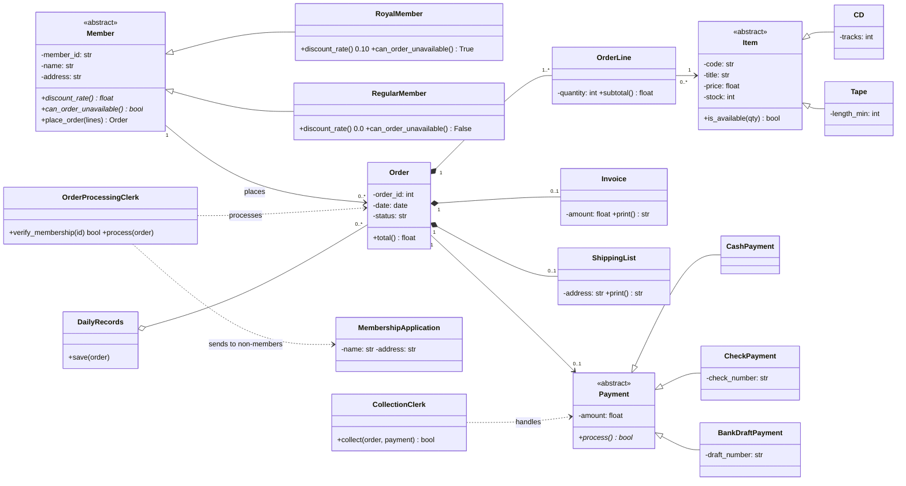
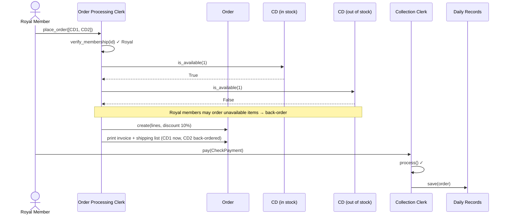
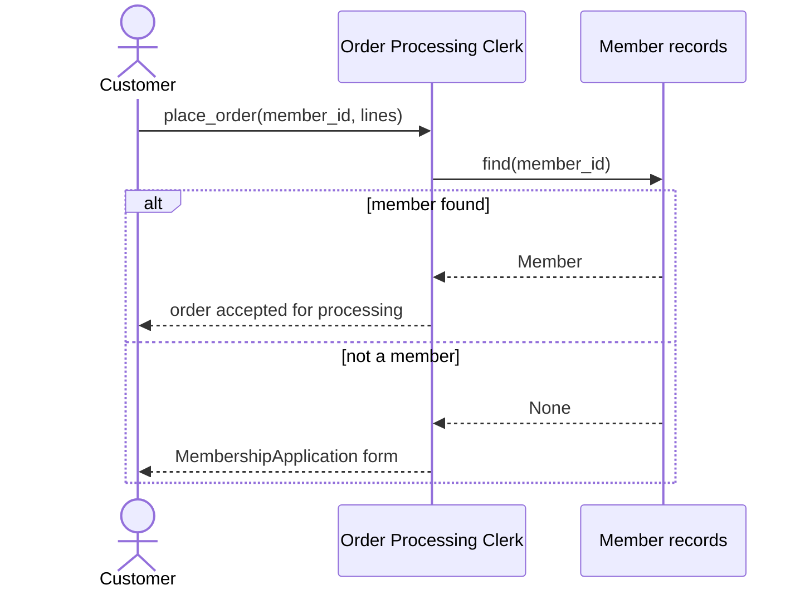
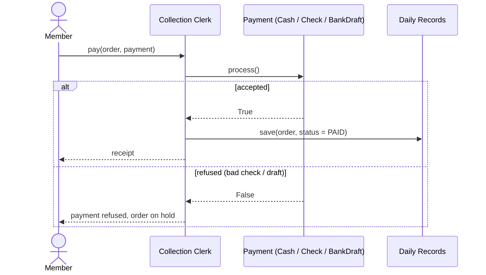
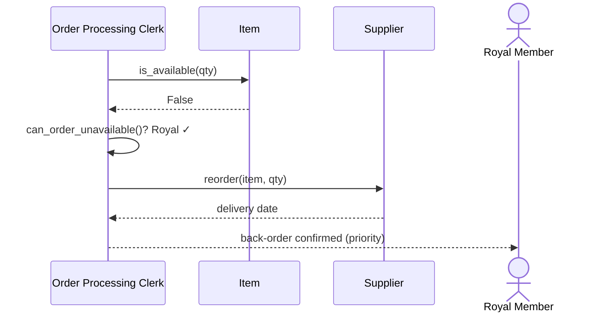

# ABCD Records

A mail-order company sells CDs and tapes at discount prices to record-club members.
- Only members can order; non-members receive a membership application form.
- Two member classes: **Royal** (discount + priority, can order unavailable items) and **Regular**.
- Payment by cash, check or bank draft.
- The Order Processing Clerk verifies and processes orders; the Collection Department Clerk handles payments.
- All orders are saved to a daily records file.

## Level 1 + 2: use case diagram

- `«include»` (mandatory): placing an order always verifies membership; processing always checks availability and prints the invoice and shipping list.
- `«extend»` (optional): a discount is applied only for Royal members; ordering unavailable items only for Royal members; the application form is sent only when verification fails (non-member).

## Level 1 + 2: class diagram

## Level 2 scenario: a Royal member orders 2 CDs (one unavailable) and pays by check

## Level 3: sequence diagrams

**Membership verification (success and failure)**

**Payment processing (all types)**

**Item reordering for Royal members**

