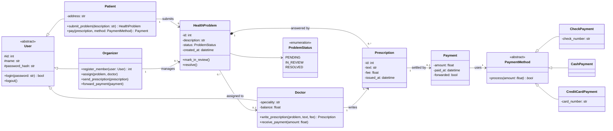
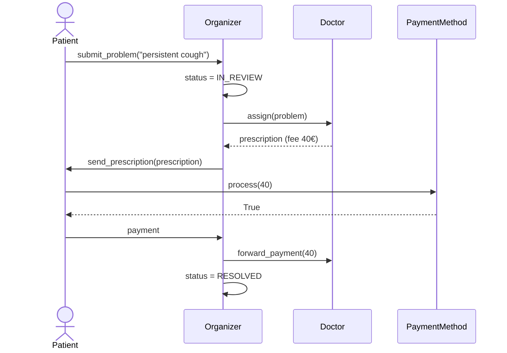
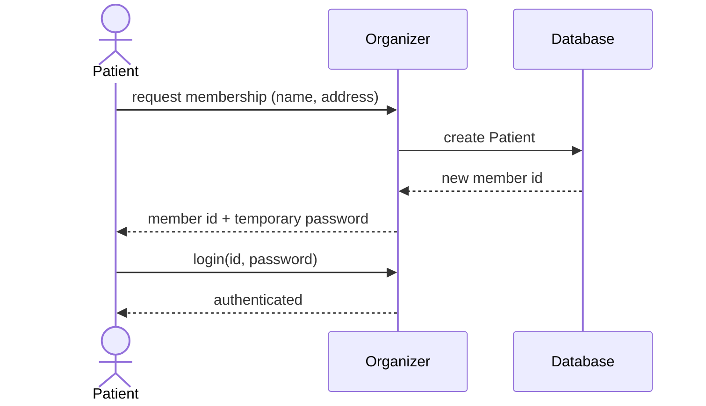
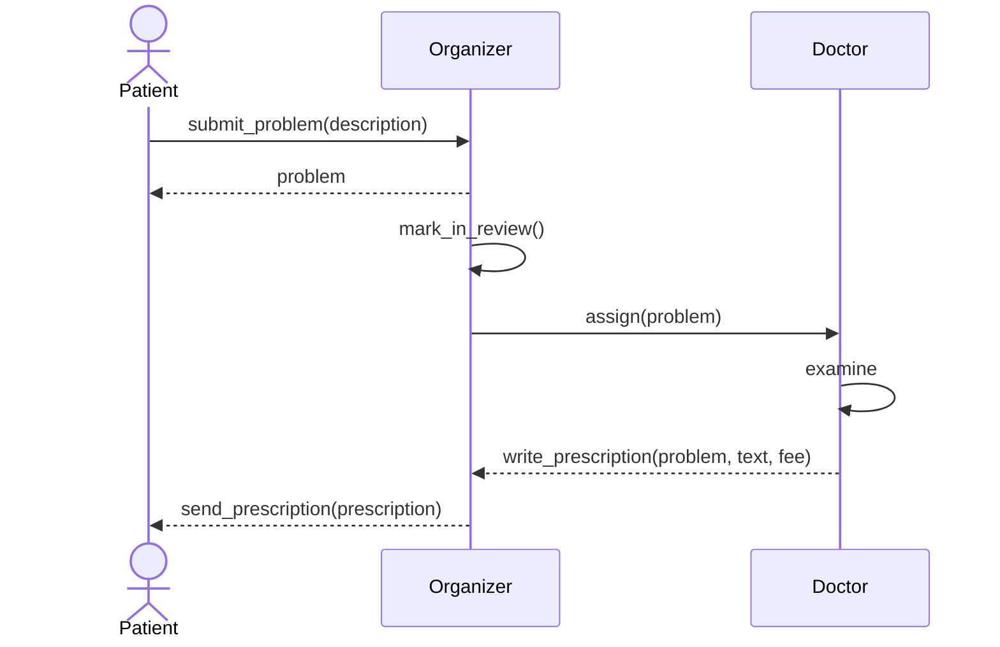
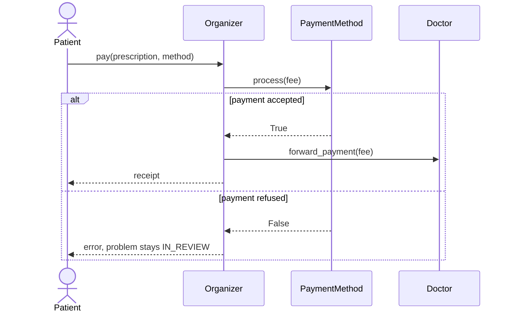
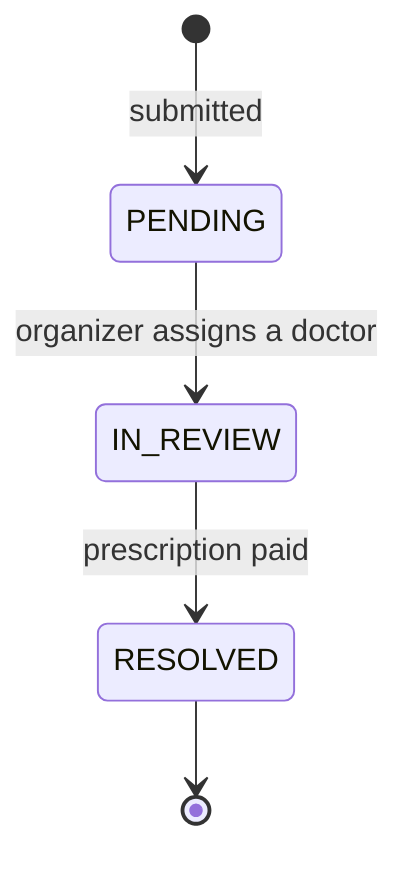

# Hospital Management System

**Workflow:** a patient posts a health problem → the organizer reads it and consults a doctor → the doctor writes a prescription → the organizer sends it to the patient → the patient pays (check, cash or credit card) → the organizer forwards the payment to the doctor. The organizer is also the administrator: they maintain the database and issue member IDs and passwords.

## Task 1 & 2: class diagram (with the Task 3 additions)

Design choices:
- `User` superclass: id, name, password and login/logout are shared by every actor (Task 3).
- Payment types use **polymorphism**. `Payment` holds a `PaymentMethod`, and each subclass implements `process()`. This is the Strategy pattern.
- `HealthProblem ◆ Prescription` is a composition: a prescription has no meaning without the problem it answers, and the problem keeps the history of past prescriptions.
- Status tracking with an enumeration and timestamps on each event (Task 3).

## Task 2: sequence diagram, one patient from problem to payment

## Task 3: system sequence diagrams

**Patient registration**

**Consultation flow**

**Payment processing**

## HealthProblem lifecycle

## Questions to consider

| Question | Answer |
|---|---|
| A patient consulting multiple doctors? | Each `HealthProblem` is assigned to one doctor, and a patient has `0..*` problems, so several doctors are reached through several problems. For a second opinion on the same problem, make the association `HealthProblem "0..*" -- "1..*" Doctor` or add a `Consultation` association class. |
| Reusable prescriptions? | Split a `Medication` / `Treatment` catalogue (reusable, aggregation) from the `Prescription` instance (composition with its problem, with dosage and date). Renewals reference the previous prescription. |
| Which pattern for payments? | **Strategy**: `PaymentMethod` is the strategy interface, Check/Cash/CreditCard are the concrete strategies, and `Payment` is the context. A **Factory** can create the method from the patient's choice. |
| Data integrity during payments? | Make payment + forwarding atomic (a database transaction), forward only after a successful `process()`, keep payments idempotent (one payment per prescription, checked with `forwarded` / a unique key) and log every step. |
