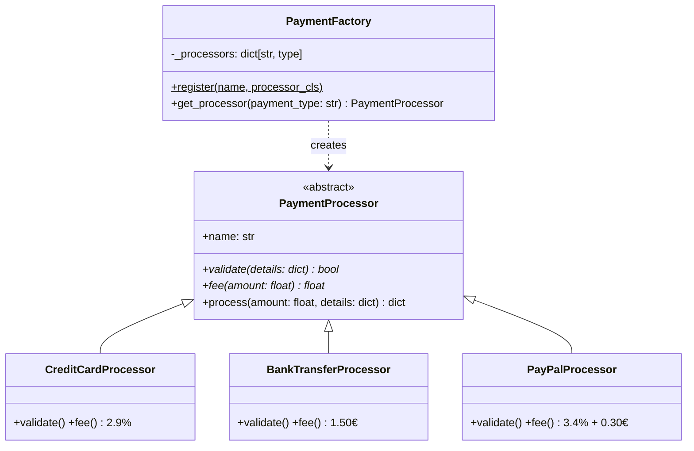

# Factory Method: payment system

## Problems in the legacy code (`legacy_payment.py`)
- One `if/elif` branch per payment method: adding Apple Pay or crypto means **modifying** `process_payment`, which violates the **Open/Closed** principle and risks breaking the whole checkout.
- Validation, fee calculation and result formatting are mixed in one function, which violates **Single Responsibility**.
- Methods can't be tested in isolation.

## Design



- `process()` is written once in the abstract class. It validates, computes the fee and builds the result. Each subclass only implements `validate()` and `fee()`. This is a small Template Method inside the Factory.
- The factory maps strings to classes in a **dictionary**, so there is no `if/elif`. New methods are added with `PaymentFactory.register("apple_pay", ApplePayProcessor)`, without editing existing code.

```python
factory = PaymentFactory()
processor = factory.get_processor("credit_card")
result = processor.process(100.0, {"card_number": "1234567890123456", "cvv": "123"})
```

Run: `python payment_factory.py` · `pytest .`
