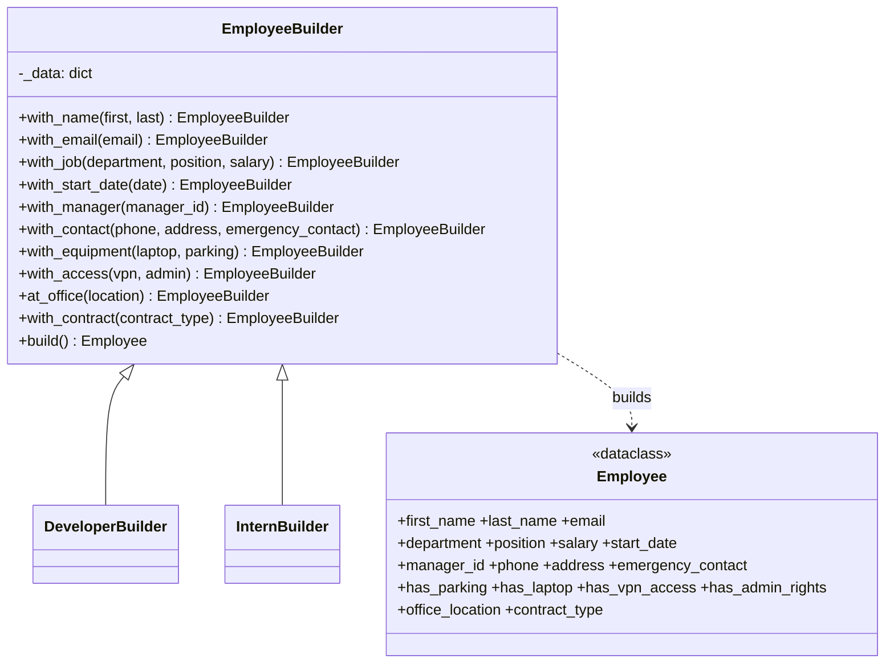

# Builder: HR employee onboarding

## Problems in the legacy code (`legacy_employee.py`)

| Code smell | Impact |
|---|---|
| Position dependency | Miss one `None` and every following argument shifts. |
| Cognitive load | Nobody knows what `False, True, True, True` means without the docs. |
| Hidden logic | Nothing guarantees that a Senior Developer always gets admin rights. |
| Scattered validation | Checks run *after* the dict is built. |

## Design



- Every `with_*` method returns `self`, so calls chain into a readable sentence.
- `build()` is the **single place** for validation, and it returns a frozen `Employee`.
- Presets (`DeveloperBuilder`, `InternBuilder`) encode the hidden business rules once.

```python
employee = (EmployeeBuilder()
            .with_name("John", "Doe")
            .with_email("john.doe@company.com")
            .with_job("Engineering", "Senior Developer", 75000)
            .with_equipment(laptop=True, parking=False)
            .with_access(vpn=True, admin=True)
            .build())
dev = DeveloperBuilder("John", "Doe", "john.doe@company.com").build()
```

Run: `python employee_builder.py` · `pytest .`
