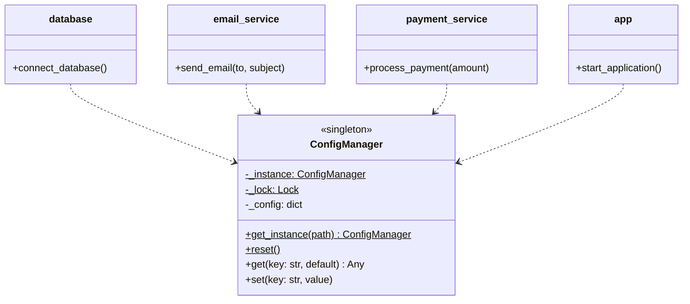

# Singleton: configuration manager

## Problems in the legacy code (`legacy_config.py`)
- The file is read on **every call** (four reads for one request), which is wasteful and slow I/O.
- There is no shared state: each module gets its own copy.
- Changes are not synchronised: a module that modifies its copy is not seen by the others.
- It's hard to mock in tests because there's no single point to override.

## Design



- `get_instance()` loads `config.json` on the first call only (lazy initialisation) and returns the same object afterwards.
- `get("database.host")` walks the nested keys.
- `set()` updates the shared instance, so every module sees the change.
- A `threading.Lock` makes the first creation thread-safe. `reset()` exists so tests can start from a clean state.
- Calling `ConfigManager()` directly raises an error, so people must go through `get_instance()`.

```python
config = ConfigManager.get_instance()      # first call: reads the file
config = ConfigManager.get_instance()      # same object, no file read
db_host = config.get("database.host")
```

Run: `python services.py` · `pytest .`
