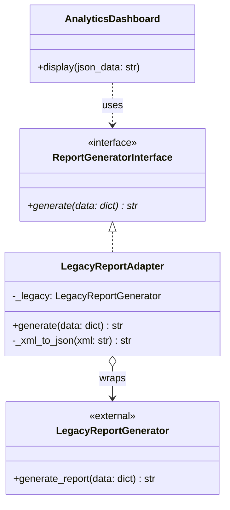

# Adapter: XML reports for a JSON dashboard

## Problems in the legacy code (`legacy_reports.py`)
- **Incompatible interfaces:** `LegacyReportGenerator` returns XML, but `AnalyticsDashboard` expects JSON.
- **Conversion logic repeated** in every report function, and it "cheats" by re-dumping the original data instead of converting the XML.
- **The legacy system can't be modified** because it's an external library.
- **Tight coupling:** business logic is mixed with format conversion.

## Design



Roles: **Client** = dashboard, **Target** = `ReportGeneratorInterface`, **Adapter** = `LegacyReportAdapter`, **Adaptee** = `LegacyReportGenerator`.

The adapter really parses the XML (`xml.etree.ElementTree`) and converts numeric strings back to `int`/`float`, so the dashboard receives proper JSON types.

```python
report_generator = LegacyReportAdapter(LegacyReportGenerator())
json_report = report_generator.generate({"total_sales": 150000, "orders": 1234})
dashboard.display(json_report)        # the dashboard never knows it's talking to a legacy system
```

Run: `python report_adapter.py` · `pytest .`
