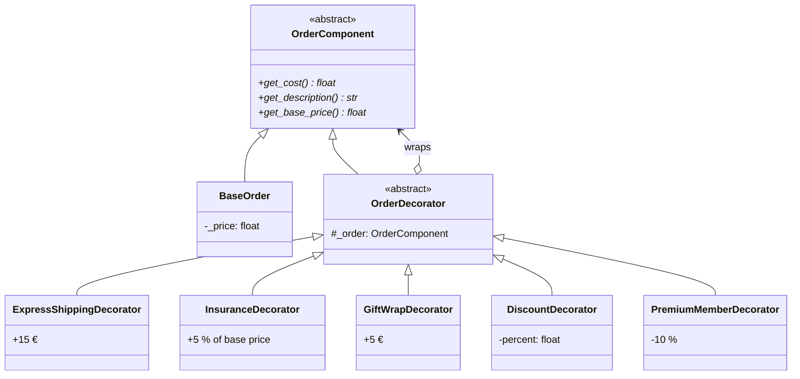

# Decorator: order pricing

## Problems in the legacy code (`legacy_order.py`)
- **Boolean flag explosion:** 5 flags, and every new option is another parameter.
- **One method does everything,** which violates Single Responsibility.
- **Hard to extend:** a new option means modifying the existing method (Open/Closed).
- **Options can't be reused:** the insurance logic is stuck inside this method.
- **The order of operations is unclear:** is the discount applied before or after shipping?

## Design



- Each decorator **is an** `OrderComponent` (same interface) and **has an** `OrderComponent` (the wrapped order). It adds its own cost and description, then delegates.
- The order of operations is now explicit: it's the wrapping order. The tests check that stacking decorators in the legacy order gives exactly the legacy total.
- `_order` is protected (single underscore) so subclasses can access it. Insurance uses `get_base_price()` to keep the legacy rule (5 % of the base price).

```python
order = BaseOrder(100.00)
order = ExpressShippingDecorator(order)
order = InsuranceDecorator(order)
order = GiftWrapDecorator(order)
order = DiscountDecorator(order, percent=15)
order = PremiumMemberDecorator(order)
print(order.get_description())
print(f"Total: {order.get_cost()}€")
```

Run: `python order_decorators.py` · `pytest .`
