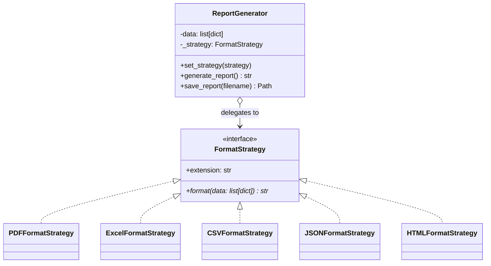

# Strategy: report formats

## Problems in the legacy code (`legacy_report_generator.py`)
1. **A new format (XML, Markdown) means editing two `if/elif` chains,** in `generate_report` and in `save_report`. This violates **Open/Closed**.
2. **Duplication:** the format decision is made twice, and the file extension is hard-coded in each branch.
3. **Testability:** each format can only be tested through the whole class.
4. **No runtime switching:** the format is a string passed on every call, with no object that encapsulates the behaviour.
5. **Silent failures:** an unknown format returns `"Unknown format"` instead of raising.

## Design

- **Context** = `ReportGenerator`. It holds a strategy and delegates `format()` to it, and it is never edited when a format is added.
- **Strategies** = one class per format. Each one knows its own file extension, so `save_report` needs no `if/elif` either.
- **Final test from the exercise:** `HTMLFormatStrategy` was added as a new class, with no change to any existing class. `test_strategy_reports.py` checks that.

Run: `python strategy_reports.py` · `pytest .`
