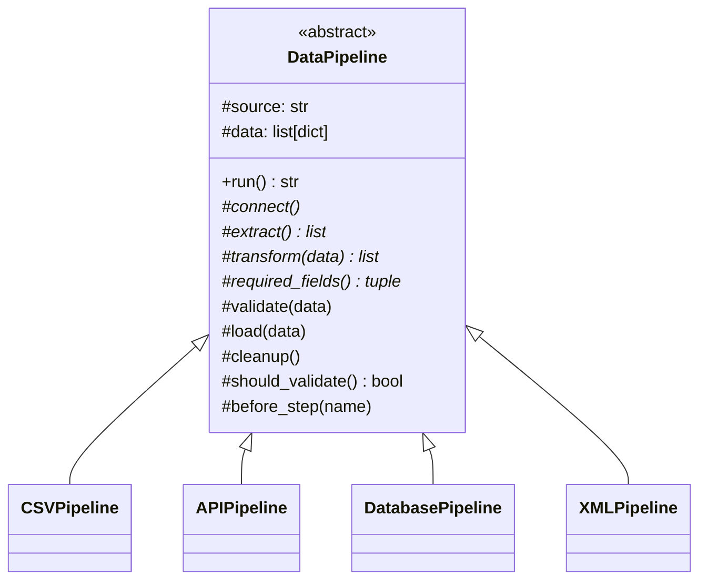

# Template Method: data ETL pipelines

## Problems in the legacy code (`legacy_pipelines.py`)
1. **Validation is repeated 3 times,** and so is cleanup.
2. **Adding logging to all pipelines means editing 3 classes.**
3. **Changing the workflow order means editing 3 classes,** with a risk of inconsistency.
4. **About 70 % of each class is duplicated** (connect/load/cleanup messages, timing, validation loop).
5. **Nothing guarantees a pipeline runs every required step.**

## Design

- **Template method** `run()`: connect → extract → transform → validate → load → cleanup. The order is defined once and can't be skipped, because subclasses don't override `run()`.
- **Abstract steps** (must be implemented): `connect`, `extract`, `transform`, `required_fields`.
- **Shared steps** (implemented once): `validate`, `load`, `cleanup`.
- **Hooks** (optional, with a default): `should_validate()` defaults to `True`; `before_step()` is an empty logging hook, so adding logging to every pipeline is one override.
- **Validation from the exercise:** `XMLPipeline` was added with XML-specific extraction and transformation, writing only what is unique to it.

Run: `python etl_pipelines.py` · `pytest .`
