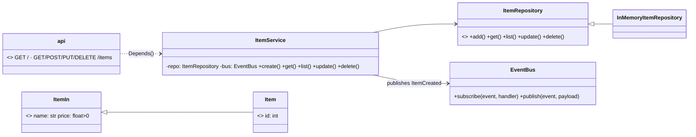

# 10 · REST API with FastAPI + OOP good practice

Slides: *Decorators: FastAPI example* ("go to fastapi.tiangolo.com/#installation") and the course goal *"Build REST APIs with FastAPI and understand event-driven architecture"*. It starts from the FastAPI first-app example, then organises a small **items catalogue** API with the OOP principles from the course.

## Architecture



| Layer | File | Principle |
|---|---|---|
| Routes (thin) | `app/api.py` | Route **decorators** `@router.get/post/...`; **dependency injection** with `Depends()` |
| Business logic | `app/service.py` | Single Responsibility: no HTTP and no storage details |
| Data access | `app/repository.py` | **Dependency Inversion**: the service depends on the abstract `ItemRepository` |
| Validation | `app/models.py` | Pydantic models: a bad body is rejected with `422` automatically |
| Events | `app/events.py` | A minimal in-process **event bus**: the service publishes `ItemCreated` without knowing who listens (the idea behind event-driven architecture; in production this would be Kafka, RabbitMQ or Temporal) |

## Run

```bash
pip install -r ../requirements.txt
uvicorn app.main:app --reload        # from this folder
# open http://127.0.0.1:8000/docs for the interactive Swagger UI
pytest .
```

The tests use FastAPI's `TestClient` and `app.dependency_overrides` to inject a fresh repository for each test. This is the same dependency-injection idea that makes the service easy to test.
